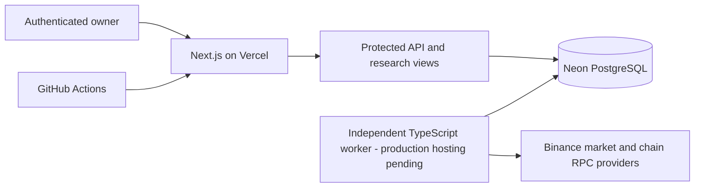

# Flownix

Private, evidence-first **long-term Binance Alpha accumulation research**. Monitor chain/contract identities across days, weeks and months; preserve observations, investigate transfers and record conservative paper experiments. Independent of Binance. No live execution, trading keys, wallet signing, paid calls or fabricated performance.

The earlier Phase 2 snapshot had real persisted observations: **686 official Alpha identities (378 online), 20 tokens with Alpha market quotes and 180 canonical ETH/BSC transfers**. Three receipt samples were independently checked. **The full live-data gate remains incomplete:** historical RPC replay/resume fails and Base logs are rate-limited. No genuine long-term accumulation signal or profitable strategy is claimed. See [current coverage](docs/DATA_COVERAGE.md).

Latest recovery results and current limits: [local automatic acceptance](docs/LOCAL_AUTOMATIC_ACCEPTANCE_2026-11-21.md). Recently collected tickers and fresh provider prices are reported separately.

Production dashboard: **https://flownix.xyz**, protected by GitHub OAuth for the configured owner. Existing Neon persistence and owner sign-in/logout are verified; the continuous production worker has not been deployed. Settings is included in **Data Health** (`/settings`). See [deployment](docs/DEPLOYMENT.md), [authentication](docs/AUTH_SETUP.md), and [remaining work](docs/NEXT_STEPS.md).

Worker hosting is **undecided**. No paid hosting was activated. Compare [measured consumption and hosting costs](docs/WORKER_HOSTING_COMPARISON.md) and [portable deployment procedures](docs/WORKER_DEPLOYMENT.md). Vercel hosts the web app; Neon remains the only production database.

## Local setup

Requires Node 22.12+ (22.x), pnpm 11.21, Docker (or an existing PostgreSQL/Neon database). From the repository root:

```sh
corepack enable
pnpm install --frozen-lockfile
cp .env.example .env
docker compose up -d
pnpm db:migrate
pnpm providers:smoke
pnpm worker:dev
```

In another terminal:

```sh
pnpm dev
```

Open **http://127.0.0.1:3000**. The web listener is private. No OAuth is needed for direct local development; remote/forwarded access and production local bypass are denied. Keep the worker running independently of the browser. Without a successful registry sync the app displays an explicit unavailable universe, never a demo watchlist.

```sh
pnpm run doctor              # database, official registry, heartbeat, freshness, jobs, costs
pnpm run doctor --rpc            # optional bounded RPC connectivity checks
pnpm worker:once             # one due-job sweep; failures stay queued with retry
pnpm typecheck
pnpm lint
pnpm test                    # unit + database integration when DATABASE_URL is configured
pnpm build
pnpm test:e2e                # Chromium required; CHROME_PATH may select an existing installation
pnpm audit:deps
```

`pnpm start` serves a production build on loopback; production always requires OAuth mode. For a remote host, configure OAuth before changing the host binding through the platform's documented start command. Never expose local bypass behind a reverse proxy.

## Implemented

- pnpm TypeScript workspace, PostgreSQL migrations, Drizzle writes, persistent leased jobs, retry/backoff, worker heartbeat and audit counters.
- Official Alpha-only registry normalization, full raw membership snapshots and removed/offline history; alphaId-to-exchange base/quote mapping; selected real ticker/candle backfill with provenance. All rows require an official registry response.
- Protected Radar, durable Accumulation Watchlist, token detail with range/custom history and source timeline, sourced labels, Wallet Detective, cross-token exchange-label counts, Alerts, Journal, Runner Lab candidate verification, Performance Lab and Data Health.
- BSC/Ethereum/Base RPC adapters: confirmed Transfer logs, exact quantities, duplicate protection, cursor restart, block-hash reconciliation and bounded balance samples. Actual network support is reported from observed scans, not the presence of an adapter.
- Explainable transfer-activity rule, cooldown and immutable evidence; purchase-ledger persistence calculation with honest unavailable coverage until swaps are verified.
- In-app notifications, optional Telegram outbox/test receipts, manual observed-book paper entries/exits with cost/exposure/size guards, hourly forward-outcome scenarios, CSV exports.
- Original Flownix vector/PNG branding, dark/light terminal, responsive tables, keyboard search, custom 404, noindex metadata and private routes.

Analysis windows: 1/3/7/14/30/60/90/180 days, full collected history and custom date ranges. A selector never creates missing history. Research states and notes persist; flat price does not remove a thesis.

## Credentials and cost

PostgreSQL is required for persistence. Public Binance market routes need no trading key. RPC URLs are server-only environment configuration; reliable archive/log providers may need an optional provider key. Remote access needs GitHub OAuth client/secret, NEXTAUTH_SECRET, NEXTAUTH_URL and GITHUB_ALLOWED_LOGIN. Telegram is optional and needs bot token/chat ID plus explicit enablement. **No seed phrase, private key or exchange trading key is ever required.**

Current adapters make no paid enrichment calls. Nansen/Bitquery/Arkham are not runtime requirements. Costs shown are API costs recorded by the worker, not hosting/storage charges. Review provider terms/quotas and legal availability before operation; do not bypass geographic restrictions.

## Limits and evidence

Transfers do not prove buys or accumulation. No verified DEX swap adapter, complete holder census, independently verified entity registry, historical Alpha archive or realized-return advantage exists in this release. Specialized supply-lock/quiet-accumulation/distribution/farming engines and statistically valid baseline comparisons remain gated future work. Market collection rotates bounded stale-first batches (default 100) across all active pairs; automatic investigation-queue identities also receive intensive depth/candle and wallet research. Every registry identity retains metadata, and missing or stale source prices remain explicit.

See [architecture](docs/ARCHITECTURE.md), [sources](docs/SOURCES.md), [coverage](docs/DATA_COVERAGE.md), [signals](docs/SIGNALS.md), [backtest policy](docs/BACKTEST.md), [operations](docs/OPERATIONS.md), [testing](docs/TESTING.md), [JCT/BTW case](docs/CASE_STUDY_JCT_BTW.md), and [brand](docs/BRAND.md).

Delivery details and exact verification limits: [build report](docs/BUILD_REPORT.md). pnpm 11 reserves the bare `doctor` command; use `pnpm run doctor` for the Flownix diagnostic.

---

## Cloud Engineering & DevOps

*Project-specific implementation record for technical interviews and portfolio review. Items below distinguish completed work from unverified or planned infrastructure.*

### Cloud platforms
- Production web application hosted on Vercel with managed PostgreSQL on Neon; GitHub OAuth protects owner-only research routes.
- Custom domain flownix.xyz with documented DNS/TLS and environment/secrets configuration.
- A separately runnable ingestion worker exists; **continuous production worker hosting is pending**.

### DevOps & CI/CD
- GitHub Actions validates code; repository documents typechecking, lint, tests and browser journeys.
- Docker Compose supports the **local** PostgreSQL/development environment; portable worker container/host procedures are documented, not represented as a proven 24/7 deployment.
- PostgreSQL migrations, Drizzle persistence, leased background jobs, retry/backoff and worker heartbeat are implemented.

### Networking & API engineering
- Server-side market-data and ETH/BSC/Base RPC integrations with explicit provider failures, quota limits and source provenance.
- GitHub OAuth, protected API routes and session boundaries; external HTTP/TLS and custom-domain troubleshooting are documented.

### Monitoring & reliability
- Data Health diagnostics, job heartbeat, freshness checks, source coverage and cost counters support investigations.
- Production provider limits, RPC replay and historical-coverage failures remain disclosed; no verified database restore drill or full production availability target is claimed.

### Architecture & infrastructure diagram



**Deployment:** https://flownix.xyz

**Technical documentation and proof:** [Architecture](docs/ARCHITECTURE.md) · [Deployment](docs/DEPLOYMENT.md) · [Worker procedures](docs/WORKER_DEPLOYMENT.md) · [Operations](docs/OPERATIONS.md) · [Evidence limits](docs/DATA_COVERAGE.md) · [CI](.github/workflows/ci.yml).

**Evidence boundary:** The current worker is not a continuously operating production collector. Terraform, Kubernetes, Redis queues and proven backup/restore are **not** claimed unless later implemented and tested.
